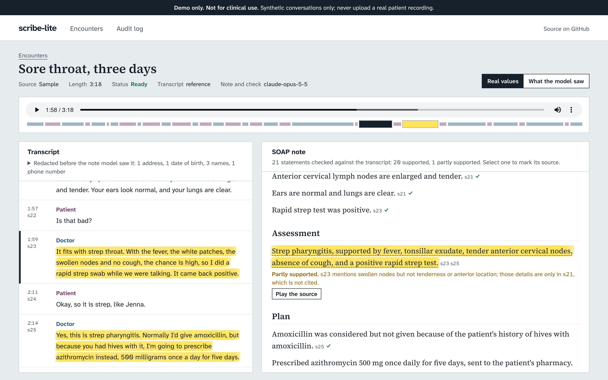
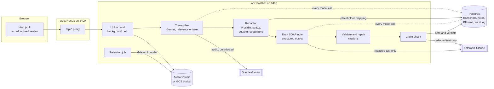

# scribe-lite

> **Demo only. Not for clinical use. Synthetic data only.** Every conversation, name, date
> of birth, phone number and address in this repository is invented. Never upload a real
> patient recording.

An open-source demo of an AI medical scribe: a recorded doctor-patient conversation
becomes a SOAP note in which every sentence links back to the part of the transcript it
came from, and a second model pass flags sentences the transcript does not support.

<!-- Demo GIF placeholder: record the sample flow (open a sample, select a statement,
     play the source, switch to "What the model saw") and save it as docs/demo.gif. -->
**Demo GIF:** placeholder, not recorded yet.



*Screenshot taken with headless Playwright from the Docker Compose stack.*

## What it does

- **Record or upload.** Record in the browser (MediaRecorder) or upload a file. The
  browser converts recordings to 16 kHz mono WAV before upload.
- **Transcribe with speaker labels.** A provider interface with three implementations:
  Gemini (`gemini-3.8-flash` by default), a reference transcriber that serves the
  scripted ground truth for the bundled samples, and a fake for tests.
- **Redact before any text reaches the note model.** Presidio with a spaCy model and
  custom recognizers replaces names, dates of birth, phone numbers and addresses with
  stable placeholders (`[PERSON_1]`, `[DATE_OF_BIRTH_1]`). The mapping stays in the local
  database and is reversed for display.
- **Write a sourced SOAP note.** `claude-opus-5-5` returns structured output validated
  with Pydantic: four sections of statements, each with `source_segment_ids`. Unknown IDs
  are repaired or the statement is rejected.
- **Check every claim.** A second Claude pass labels each statement supported, partly
  supported or not supported, with a one-line reason. The UI flags anything not fully
  supported.
- **Audit and retention.** One audit row per model call (time, provider, model,
  purpose, prompt SHA-256, tokens, cost, latency, status). A retention job deletes audio
  after `RETENTION_DAYS`, from the CLI or on a schedule, and logs each deletion.
- **Works with no keys.** Three synthetic conversations ship with voiced audio,
  scripted transcripts and precomputed notes, so the UI is complete out of the box.

## Results

All numbers below come from real runs; the raw outputs are committed under
`eval/results/`. Three short synthetic conversations are a smoke test, not a benchmark.

### Note quality

Coverage is the share of hand-written reference facts present in the note, judged per
fact by Claude against a rubric. The unsupported-claim rate comes from the claim check.
The reference facts were written from the scripts before any note was generated
(`samples/*/reference_facts.json`).

<!-- eval-results:start -->
Generated 2026-11-11 by `eval/run_eval.py`. Note and check: `claude-opus-5-5` (effort `medium` / `medium`); coverage judge: `claude-opus-5-5`. Raw outputs are in `eval/results/`.

| Transcript | Sample | Facts | Coverage | Present / partial / absent | Statements | Unsupported | Partly supported | Rejected |
| --- | --- | --- | --- | --- | --- | --- | --- | --- |
| Scripted | ankle-sprain | 23 | 100.0% | 23 / 0 / 0 | 24 | 0 (0.0%) | 1 | 0 |
| Scripted | diabetes-follow-up | 24 | 93.8% | 21 / 3 / 0 | 28 | 0 (0.0%) | 1 | 0 |
| Scripted | sore-throat | 19 | 100.0% | 19 / 0 / 0 | 21 | 0 (0.0%) | 1 | 0 |
| **Scripted** | **all** | **66** | **97.7%** | 63 / 3 / 0 | 73 | 0 (0.0%) | 3 | 0 |
| Gemini (gemini-3.8-flash) | ankle-sprain | 23 | 100.0% | 23 / 0 / 0 | 24 | 0 (0.0%) | 1 | 0 |
| Gemini (gemini-3.8-flash) | diabetes-follow-up | 24 | 95.8% | 22 / 2 / 0 | 28 | 0 (0.0%) | 1 | 0 |
| Gemini (gemini-3.8-flash) | sore-throat | 19 | 100.0% | 19 / 0 / 0 | 21 | 0 (0.0%) | 1 | 0 |
| **Gemini (gemini-3.8-flash)** | **all** | **66** | **98.5%** | 64 / 2 / 0 | 73 | 0 (0.0%) | 3 | 0 |

Coverage = (present + 0.5 x partial) / facts. Unsupported rate = statements the claim check labelled unsupported / all statements.

Planted errors (claim check run on the scripted-transcript notes after editing them; see `eval/planted_errors.json`):

| Sample | Planted | Flagged unsupported | Flagged partly supported | Missed | Untouched statements flagged |
| --- | --- | --- | --- | --- | --- |
| ankle-sprain | 4 | 4 | 0 | 0 | 0 of 21 |
| diabetes-follow-up | 4 | 4 | 0 | 0 | 0 of 25 |
| sore-throat | 4 | 4 | 0 | 0 | 0 of 18 |
| **all** | **12** | **12** | **0** | **0** | **0 of 64** |

Known PII values found in the redacted Gemini transcripts sent to the note model: none.

Model calls behind these results: 15, $0.526252 at list prices.
<!-- eval-results:end -->

Reading the numbers:

- **The notes miss very little.** Every partial verdict is on the diabetes sample. Two are
  my fault: the reference facts say "type 2 diabetes", but nobody says "type 2" in the
  conversation, so a note that sticks to the transcript can only be partial on them.
- **The judge is not perfectly consistent.** In the first evaluation run the same
  omission was scored partial for one note and present for the other. Read differences of
  a point or two between the two transcript conditions as noise.
- **No statement was unsupported**, so the natural unsupported rate cannot show whether
  the checker works. The planted-error test does: twelve deliberate mistakes (wrong dose,
  wrong number, wrong side, flipped negation, reversed decision, invented order, invented
  diagnosis) were edited into the notes, and the check labelled all twelve unsupported
  without flagging any of the untouched statements.
- **The planted errors changed the checker.** In the first run, four of them (a wrong side,
  two wrong doses and a wrong temperature) came back only "partly supported". The prompt
  now says any contradicted detail makes the whole statement unsupported. The first run is
  kept in `eval/results/history/`.

### PII redaction recall

An occurrence counts as caught only if every letter and digit of it was redacted
(`eval/pii_recall.py`, results in `eval/results/pii_recall.md`).

| Set | Caught | Recall | Names | Dates of birth | Phones | Addresses |
| --- | --- | --- | --- | --- | --- | --- |
| The three samples | 23 / 23 | 100% | 14/14 | 3/3 | 3/3 | 3/3 |
| Held-out set (25 short cases) | 31 / 32 | 96.9% | 16/16 | 5/5 | 5/5 | 5/6 |

The samples and the recognizers were written by the same person, so 100% on them says
little. The held-out set (`eval/pii_holdout.json`) was written before the redactor was
run on it and never used for tuning. Its one miss is a street name with no house number
("on Elm Street"). One recognizer, for a first name right after a greeting ("Hi Priya,"),
was added after the held-out run, prompted by an API test; held-out recall did not
change. Nothing was over-redacted in either set.

### Transcription

`gemini-3.8-flash` labelled every aligned word with the right speaker on all three
samples, with no merged turns. `gemini-3.5-flash-lite` recognised words just as well but
merged turns and drifted by about 40 seconds on two samples. The cost of the better
labels is speed: 3 to 4 minutes per 3.3-minute recording on the free tier, against 8
seconds. Details and the limits of LLM-based diarization are in
[docs/transcription.md](docs/transcription.md).

| Model | Speaker accuracy | WER | Merged turns | Time per recording |
| --- | --- | --- | --- | --- |
| gemini-3.8-flash | 100.0% | 1.4% | 0 | 181 to 235 s |
| gemini-3.5-flash-lite | 93.7% | 1.3% | 7 | 8 to 9 s |

## Architecture



Each pipeline step commits its results and moves the encounter's status forward, so the
UI shows progress and a failure keeps everything up to the failed step. The browser only
talks to the Next.js server, which forwards `/api/*` to `API_URL` at request time, so the
same images run locally, in Compose and on Cloud Run.

## Privacy design

This is a demo, but the design follows what a real scribe has to get right.

**What leaves the machine.** For a new recording, the **audio goes to Google Gemini
unredacted**; redaction cannot help there, because the transcript does not exist yet. A
real deployment would use on-premises speech recognition or a speech service covered by a
business associate agreement (or the local equivalent). After transcription, only
redacted text goes to Anthropic. The bundled samples send nothing anywhere: they use the
scripted transcripts and precomputed notes.

**How redaction works.** The whole transcript is analysed as one document, so a date of
birth given in the patient's turn is linked to the doctor's question in the turn before
it. Presidio's spaCy recognizer finds most names; custom recognizers add dates of birth
(a date counts only when a cue such as "date of birth" or "born" is nearby, so clinical
dates stay readable), street addresses with unit, city and postal code, names after a
title or greeting, and phone numbers written or read out digit by digit. Every name
found is propagated to its other mentions. Each distinct value gets one placeholder per
encounter, and a shorter form of a name shares the full name's placeholder, so the model
can tell "[PERSON_1]" is the same person throughout.

**Reversible only locally.** The placeholder-to-value mapping is stored in the local
database and never sent anywhere. The API restores real values in model output for the
"Real values" view; the "What the model saw" view shows the redacted text with each
placeholder marked. A test checks that none of the samples' known personal details
appear in any prompt.

**What redaction does not cover.** Ages, visit dates, a city mentioned on its own, an
employer ("I work at a warehouse"), family relationships and rare conditions all pass
through. Together these can identify someone. Redaction lowers the risk of sending
direct identifiers; it does not make text anonymous.

**Audit log.** Every call to a hosted model writes one row: time, provider, model,
purpose, a SHA-256 of the full prompt (model, settings, system prompt, redacted messages,
output schema), tokens, cost at list prices, latency, status and error. Failed, refused
and rate-limited calls are logged too. Prompt text itself is not stored. Rows survive
deletion of their encounter.

**Retention.** Audio is deleted `RETENTION_DAYS` (default 30) after upload by
`scribe retention run` or the API's interval schedule. Each deletion is logged and
recorded in `retention_deletions`. Transcripts and notes are kept; a real system needs a
policy for those too.

**What is missing for real use.** There is no authentication: anyone who can reach the
web port can read everything. A real deployment would also need agreements with every
processor, zero-data-retention terms with the model providers, encryption keys you
control, and an append-only audit store.

## Setup

### With Docker (no keys needed for the samples)

```sh
git clone https://github.com/GillParm/scribe-lite && cd scribe-lite
cp .env.example .env              # optional: add ANTHROPIC_API_KEY and GEMINI_API_KEY
docker compose up --build
```

Open http://localhost:3400. The API is on http://localhost:8400 (OpenAPI docs at
`/docs`) and Postgres on port 5434. Without keys the three samples work fully; recording
or uploading new audio needs both keys.

### For development

Requirements: Python 3.12 with [uv](https://docs.astral.sh/uv/), Node 24, Docker.

```sh
make hooks                         # enable the pre-commit secret scan
make db                            # Postgres on localhost:5434
make api                           # migrations, then the API on :8400 (seeds the samples)
cd frontend && npm ci && cd ..
make web                           # Next.js on :3400
```

| Command | What it does |
| --- | --- |
| `make test` | Backend tests, offline (SQLite unless `TEST_DATABASE_URL` is set) |
| `make lint`, `make typecheck` | Ruff, Prettier, ESLint; strict mypy and tsc |
| `uv run scribe retention run --dry-run` | List audio past the retention window |
| `uv run scribe samples seed` | Import the samples into the database |
| `uv run scribe samples rebuild` | Re-run the real pipeline on the samples (needs `ANTHROPIC_API_KEY`) |
| `uv run python ../eval/run_eval.py` | Rebuild the results tables from saved outputs (no calls unless outputs are missing) |
| `make samples` | Re-voice the samples with macOS `say` |
| `RUN_LIVE_TESTS=1 uv run pytest -m live` | Live smoke tests against Gemini and Claude |

Settings come from environment variables (see `.env.example`): models and effort
levels, `TRANSCRIBER` (`auto`, `gemini`, `reference`), `RETENTION_DAYS`, `DATA_DIR`,
`DATABASE_URL`.

## Testing and CI

`uv run pytest` runs 142 tests offline, against Postgres when `TEST_DATABASE_URL` is set
and SQLite otherwise. They cover redaction and its reversal, PII recall on the samples,
the note schemas and citation repair, claim-check parsing, the audit log, retention with
a fake clock, the Gemini client against a stub (including 429 backoff), the pipeline end
to end with fake providers, and the HTTP API. Two live tests are skipped unless
`RUN_LIVE_TESTS=1` is set.

GitHub Actions runs ruff, strict mypy and pytest against a Postgres 17 service
container, ESLint, Prettier and tsc for the web app, builds both Docker images, and scans
the history with gitleaks. A pre-commit hook runs gitleaks locally.

## Deployment

Both Dockerfiles are Cloud Run-ready: non-root, listening on `$PORT`.
[docs/deploy-cloud-run.md](docs/deploy-cloud-run.md) describes Cloud SQL for Postgres, a
Cloud Storage bucket mounted for audio, Secret Manager for keys, and a Cloud Run job with
Cloud Scheduler for retention. **That deployment has not been run live.**

## Decisions

The brief left most choices open; these are the ones that shaped the result.

- **Opus 5.5 at medium effort for both passes.** A note plus its check costs $0.06 to
  $0.08 per 3-minute encounter at list prices. Thinking cannot be turned off on this
  model; effort is the depth control. Server-side refusal fallbacks are enabled, so a
  declined request is retried on a fallback model, and the audit log records which model
  answered.
- **Reject, don't guess, bad citations.** IDs like `S4`, `seg-4` or `s3-s5` are
  normalised; unknown IDs are dropped; a statement left with no valid source is removed
  and listed under the note rather than shown. No sample note needed this.
- **A statement with one wrong detail is unsupported.** Changed after the planted-error
  run, described above.
- **Model order over model timestamps.** An early version sorted Gemini's segments by
  start time; one flash-lite transcript had overlapping times and the sort scrambled the
  conversation. The app now keeps the model's order and only makes times monotonic.
- **spaCy `en_core_web_md` rather than `lg`.** The medium model takes 55 MB in the image
  and recall was already high on both sets, so the much larger `lg` model was not tried.
- **Browser-side WAV conversion.** MediaRecorder output differs by browser (WebM/Opus,
  MP4). Converting to 16 kHz mono WAV in the browser keeps ffmpeg out of the API image.
- **A runtime proxy instead of a public API URL.** `NEXT_PUBLIC_*` variables are baked in
  at build time; reading `API_URL` per request lets one web image serve every
  environment.
- **SQLite fallback for tests.** `uv run pytest` works on a fresh clone with no services.
  CI runs the same tests on Postgres; a `UTCDateTime` type and an SQLite foreign-key pragma
  keep the two consistent.
- **Precomputed sample outputs include their audit rows,** imported with
  `origin=sample_import`, so the audit page is honest about which calls this deployment
  made.

### Changes from the plan

[docs/plan.md](docs/plan.md) was written before any code. Where the build departed from it:

- **Two extra evaluations.** A planted-error test for the claim check, because no
  generated statement was unsupported, and a held-out PII set, because recall measured
  only on the samples would be self-graded.
- **The claim-check rubric changed** after the first evaluation run, and the sample notes
  and every reported number were regenerated afterwards.
- **Segment order.** The plan had the transcriber output sorted by start time; that was
  replaced after it scrambled one flash-lite transcript.
- **A second migration** added `origin` to the audit log, to tell imported sample calls
  from live ones.
- **Live smoke tests** for both providers were added behind an explicit opt-in.

## Limitations and what was not verified

- **In-browser recording was not tested end to end.** In headless Chromium on the build
  machine, `getUserMedia` never resolved, even with Chrome's fake audio devices, so the
  record button could not be driven by a test, and the browser-side WAV conversion has no
  automated test. The upload path, which shares everything after that conversion, was run
  live: a 38-second synthetic conversation uploaded through the UI in the Docker stack
  was transcribed by gemini-3.8-flash (after three 503 responses and a 724-second
  request), redacted (both names), written up as nine statements and checked (all
  supported). The result, as the model saw it, is in `eval/results/live/upload-test.json`.
- **Gemini free-tier latency is unpredictable.** Recorded gemini-3.8-flash requests took
  between 3 and 12 minutes. Requests time out after `GEMINI_TIMEOUT_SECONDS` (900 by
  default), and an encounter caught mid-pipeline by a restart is marked failed on the
  next start so it can be processed again.
- **Cloud Run deployment** is documented but was not run against a real project.
- **Evaluation scale.** Three short, clean, synthetic conversations with two clearly
  different TTS voices. Real clinic audio (crosstalk, noise, accents, more than two
  speakers) would be much harder, for transcription in particular.
- **LLM judge.** Coverage is judged by the same model family that wrote the notes, and
  the judge varied between runs on the same omission.
- **API image size.** About 950 MB uncompressed, mostly spaCy, its model and
  phonenumbers.

## Cost of building this

Anthropic spend for everything in this repository, from the token counts in the audit
rows at list prices ($4 / $20 per million input / output tokens for Opus 5.5):

| Work | Calls | Cost |
| --- | --- | --- |
| First sample notes and checks | 6 | $0.20 |
| First evaluation run | 15 | $0.52 |
| Sample notes and checks after the checker change | 6 | $0.21 |
| Evaluation run behind the tables above | 15 | $0.53 |
| Live upload test through Docker (note and check) | 2 | $0.02 |
| Live smoke test (one low-effort call; not logged) | 1 | under $0.02 |
| **Total** | **45** | **$1.47 plus the unlogged call** |

Gemini ran on the free tier. At paid-tier list prices the six comparison calls would
have cost $0.08 ($0.05 for `gemini-3.8-flash`, $0.02 for flash-lite).

## License

MIT. See [LICENSE](LICENSE).
